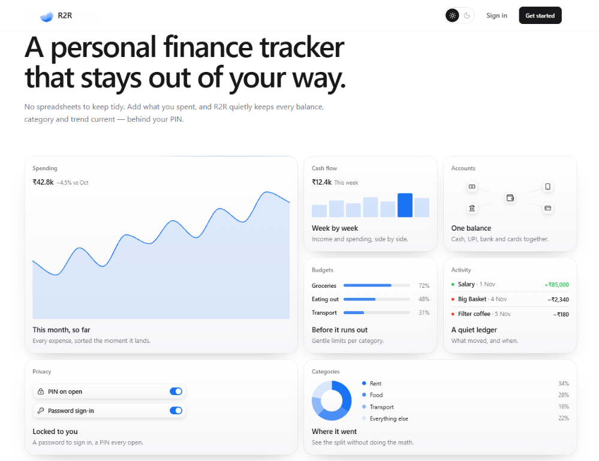

<div align="center">

# R2R

**A personal finance tracker that stays out of your way.**

Log what you spend. R2R keeps every balance, category and trend current — behind a password and a PIN.

[](https://react.dev)
[](https://vite.dev)
[](https://expressjs.com)
[](https://www.mongodb.com/atlas)
[](#progressive-web-app)

</div>



## Why R2R

Most finance apps want bank credentials, a subscription and a spreadsheet's worth of setup. R2R takes the opposite path: add a transaction in a few seconds, and the dashboard quietly keeps the running totals, category split and monthly trend correct.

- **A ledger, not a spreadsheet.** Income and expenses with account, category, date and note.
- **Balances that add up.** Cash, bank, UPI and credit-card accounts update as you log.
- **Two locks.** Password sign-in plus a PIN gate every time the app opens.
- **Light and dark.** A theme switch that follows you through the app.
- **Installable on Android.** A real PWA with an app icon, splash screen and offline app shell.
- **No third-party data brokers.** Your data lives in your own MongoDB database.

## Tech stack

| Layer | What it uses |
| --- | --- |
| Client | React 19, Vite 8, React Router 7, Tailwind CSS 3.4, Motion, Lenis, Recharts, lucide-react |
| Server | Node.js (ESM), Express 4, Mongoose 8, zod, JWT, bcrypt, express-rate-limit |
| Database | MongoDB Atlas |
| Delivery | Vercel (client) + Render (API), or a single Node service |

## Getting started

Requires **Node.js 20.19+** (or 22.12+) and a MongoDB connection string — a free Atlas cluster is enough.

```bash
npm install
npm --prefix server install
npm --prefix client install
cp .env.example .env
```

Fill in `.env` at the repository root:

| Variable | Description |
| --- | --- |
| `MONGO_URI` | MongoDB Atlas connection string |
| `MONGO_DB` | Database name (default `r2r`) |
| `JWT_SECRET` | Long random string used to sign tokens |
| `PORT` | API port (default `5000`; the example uses `5001`, which the Vite proxy expects) |
| `CLIENT_ORIGIN` | Comma-separated browser origins allowed to call the API (default `http://localhost:5173`) |

Start both apps with one command:

```bash
npm run dev
```

- Web app — http://localhost:5173
- API — http://localhost:5001 (`/api` is proxied by Vite in development, so CORS needs no setup)

### Scripts

| Command | What it does |
| --- | --- |
| `npm run dev` | API in watch mode and the Vite dev server together |
| `npm run dev:server` | API only |
| `npm run dev:client` | Vite dev server only |
| `npm run build` | Production build of the client into `client/dist` |
| `npm start` | Run the API (serves `client/dist` too when present and `NODE_ENV=production`) |

## How authentication works

1. Register with a username and password. Username availability is checked as you type.
2. Choose a **4–6 digit PIN** — the second factor.
3. Signing in asks for the password once per browser session, then the PIN.
4. Every reload, new tab or app launch asks for the PIN again. The access token lives in memory only; a `SameSite=Lax` httpOnly challenge cookie (30 minutes for setup, 30 days for the PIN step) records that the password step is done.
5. Five wrong PINs lock the PIN for 5 minutes. A password-based reset unblocks it.
6. Auth endpoints are rate-limited to 30 requests per 15 minutes per IP.

Logging out clears the challenge cookie, so the password is required again.

## Progressive web app

The client ships a web app manifest, maskable orb icons and a service worker:

- Installs from Chrome on Android with standalone display (no browser chrome), a splash screen and a themed status bar.
- The service worker caches only the app shell. **`/api` requests are never cached**, so balances and session state stay live.
- Service-worker registration runs in production builds only, so `npm run dev` is unaffected.
- Layouts respect `env(safe-area-inset-*)`, so headers and cards are not covered by the status bar or gesture area.

To install: open the deployed site in Chrome → **Install app** (or **Add to Home screen**). If an older plain shortcut exists, uninstall it first.

## API

All `/api` routes return JSON. Resource routes require `Authorization: Bearer <access token>`.

| Method | Route | Purpose |
| --- | --- | --- |
| GET | `/api/health` | Health check |
| GET | `/api/auth/username-available` | Check username availability |
| POST | `/api/auth/register` | Create an account |
| POST | `/api/auth/login` | Password step |
| GET | `/api/auth/status` | Current session state |
| POST | `/api/auth/pin/setup` | Set the PIN after registration |
| POST | `/api/auth/pin/verify` | PIN step |
| POST | `/api/auth/pin/reset` | Reset the PIN with the password |
| POST | `/api/auth/logout` | Clear the challenge cookie |
| GET | `/api/auth/me` | Current user |
| POST | `/api/auth/change-pin` | Change the PIN |
| POST | `/api/auth/change-password` | Change the password |
| GET / POST | `/api/accounts` | List / create accounts |
| PATCH / DELETE | `/api/accounts/:id` | Update / delete an account |
| GET / POST | `/api/categories` | List / create categories |
| PATCH / DELETE | `/api/categories/:id` | Update / delete a category |
| GET / POST | `/api/transactions` | List / create transactions |
| PATCH / DELETE | `/api/transactions/:id` | Update / delete a transaction |
| GET | `/api/dashboard` | Aggregated totals and chart data |

## Project structure

```
.
├── client/                  React app
│   ├── public/              Manifest, service worker, icons, favicon
│   └── src/
│       ├── pages/           Landing, auth, dashboard, transactions, accounts, categories, settings
│       ├── components/      Layout, forms, charts, UI primitives, landing bento
│       ├── context/         Auth, finance data, theme
│       └── lib/             API client and helpers
├── server/src/
│   ├── config/              Environment loading and MongoDB connection
│   ├── routes/              Auth, accounts, categories, transactions, dashboard
│   ├── models/              Mongoose schemas
│   ├── middleware/          JWT auth, error handling
│   └── utils/               Tokens, validation schemas, seeding
├── docs/                    README screenshots
└── .env.example
```

## Deployment

### Option 1 — a single service

Build the client, then start the API with `NODE_ENV=production`. When `client/dist/index.html` exists, Express serves the SPA and falls back to `index.html` for client-side routes, so one host serves everything:

```bash
npm run build
NODE_ENV=production npm start
```

Set `MONGO_URI`, `MONGO_DB`, `JWT_SECRET` and `CLIENT_ORIGIN`.

### Option 2 — Vercel (web) + Render (API)

1. **Vercel** — import the repository, set the root directory to `client`, framework Vite, build `npm run build`, output `dist`. Add `VITE_API_URL=https://api.example.com` as a production environment variable and redeploy (Vite inlines it at build time). `client/vercel.json` handles SPA route fallback.
2. **Render** — web service with root directory `server`, build `npm install`, start `npm start`, health check `/api/health`.
   ```
   NODE_ENV=production
   MONGO_URI=...
   MONGO_DB=r2r
   JWT_SECRET=<long random string>
   CLIENT_ORIGIN=https://r2r.example.com
   ```
   Do not set `PORT`; the platform provides it.
3. **Use one registrable domain for both.** The PIN challenge cookie is `SameSite=Lax`, so the site and API must share a registrable domain, e.g. site `r2r.example.com` and API `api.example.com`. Pointing the site at a `*.onrender.com` URL drops the cookie and the PIN step fails with `401 Session expired`. Add the API subdomain in Render and a `CNAME` for `api` at your registrar. Both ends must be HTTPS.
4. **MongoDB Atlas** — allow the provider's IPs (Render's egress is dynamic, so `0.0.0.0/0` is the practical setting) and use a scoped database user.
5. **PWA** — HTTPS is required for installation; both Vercel and Render provide certificates.

After deploying, open `/api/health`, then register, set a PIN, add a transaction, reload, and confirm the PIN is requested.

## Notes

- `.env` is git-ignored. Never commit credentials.
- Amounts are stored as decimal numbers and formatted with `Intl.NumberFormat('en-IN')`.
- Dates are stored as `YYYY-MM-DD` strings so time zones cannot move a transaction into the wrong day.
- All data is entered manually — R2R does not connect to banks and never asks for banking credentials.
